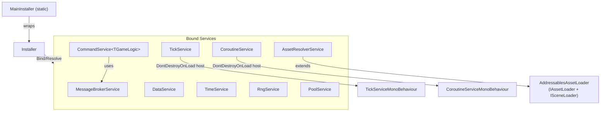

# Geuneda.Services - AI 에이전트 / 기여자 가이드

> `CLAUDE.md` 는 이 파일을 가져오기만 합니다. 내용은 이 파일(`AGENTS.md`)을 고치세요. 사용자용 진입점은 [README.md](README.md), 서비스별 사용법은 [docs/](docs/README.md) 입니다. 이 파일은 패키지 자체를 수정하는 사람을 위한 구조, 불변식, 함정을 다룹니다. 사용법 설명은 docs 에 두고 여기서는 반복하지 않습니다.

## 1. 패키지 개요

- 패키지: `com.geuneda.services` (버전과 의존성은 [package.json](package.json) 이 기준)
- Unity: 6000.3 이상
- 의존성
  - `com.geuneda.gamedata` (1.0.0): `floatP`/`MathfloatP`(RNG), `Pair<,>`/`IPairConfigsContainer<,>`(에셋 설정). 런타임 네임스페이스는 `Geuneda.DataExtensions`, 어셈블리는 `Geuneda.GameData`. Newtonsoft.Json 도 이 패키지를 통해 들어옴
  - `com.unity.addressables` (1.21.20): 에셋/씬 로딩
  - `com.cysharp.unitask` (2.5.10): 에셋 로딩 async API
- v2.0.0 에서 `com.geuneda.assetsimporter` v0.5.2 를 흡수했습니다(`Runtime/AssetsImporter/`, `Editor/AssetsImporter/`, `Editor/AddressableIds/`).

## 2. 런타임 구조

### 인터페이스 → 구현

| 인터페이스 | 네임스페이스 | 구현 | 파일 |
|------------|--------------|------|------|
| `IInstaller` | `Geuneda.Services` | `Installer`, 정적 래퍼 `MainInstaller` | `Runtime/DependencyInjection/Installer.cs`, `MainInstaller.cs` |
| `IMessageBrokerService` | `Geuneda.Services` | `MessageBrokerService` | `Runtime/MessageBrokerService.cs` |
| `ITickService` | `Geuneda.Services` | `TickService` | `Runtime/TickService.cs` |
| `ICoroutineService` | `Geuneda.Services` | `CoroutineService` | `Runtime/CoroutineService.cs` |
| `IPoolService` | `Geuneda.Services.Pooling` | `PoolService` (ns `Geuneda.Services`) | `Runtime/Pooling/IPoolService.cs`, `Runtime/PoolService.cs` |
| `IObjectPool<T>` | `Geuneda.Services.Pooling` | `ObjectPoolBase<T>`, `ObjectPool<T>`, `GameObjectPool`, `GameObjectPool<T>` | `Runtime/Pooling/` |
| `IDataProvider` / `IDataService` | `Geuneda.Services` | `DataService` | `Runtime/DataService.cs` |
| `ITimeService` / `ITimeManipulator` | `Geuneda.Services` | `TimeService` | `Runtime/TimeService.cs` |
| `IRngService` | `Geuneda.Services` | `RngService` | `Runtime/RngService.cs` |
| `ICommandService<TGameLogic>` | `Geuneda.Services.Commands` | `CommandService<TGameLogic>` (ns `Geuneda.Services`) | `Runtime/Commands/ICommandService.cs`, `Runtime/CommandService.cs` |
| `IGameCommand<T>` / `IGameServerCommand<T>` | `Geuneda.Services.Commands` | 사용자 정의 | `Runtime/Commands/IGameCommand.cs` |
| `IAssetLoader` / `ISceneLoader` | `Geuneda.Services.AssetsImporter` | `AddressablesAssetLoader` | `Runtime/AssetsImporter/` |
| `IAssetResolverService` / `IAssetAdderService` | `Geuneda.Services` | `AssetResolverService` | `Runtime/AssetResolverService.cs` |
| (정적) | `Geuneda.Services` | `VersionServices` | `Runtime/VersionServices.cs` |

## 3. 디렉터리와 네임스페이스

### Runtime (`Geuneda.Services.asmdef`, rootNamespace `Geuneda.Services`)

| 폴더 | 네임스페이스 | 비고 |
|------|--------------|------|
| `Runtime/` | `Geuneda.Services` | 구체 서비스 클래스, `AssetResolverService`, `VersionServices` |
| `Runtime/DependencyInjection/` | `Geuneda.Services` | **예외**: 폴더명이 네임스페이스에 없음. 새 파일은 `DependencyInjection` 세그먼트를 직접 지워야 함 |
| `Runtime/Commands/` | `Geuneda.Services.Commands` | 커맨드 계약(인터페이스만) |
| `Runtime/Pooling/` | `Geuneda.Services.Pooling` | 풀 계약과 구현 |
| `Runtime/AssetsImporter/` | `Geuneda.Services.AssetsImporter` | 로더 인터페이스, Addressables 로더, 설정 ScriptableObject |

`PoolService`, `CommandService` 는 루트에 있으면서 하위 네임스페이스를 `using` 합니다.

### Editor (`Geuneda.Services.Editor` 어셈블리, 파일명은 `Editor/GameLovers.Services.Editor.asmdef`)

| 폴더 | 네임스페이스 | 내용 |
|------|--------------|------|
| `Editor/Versioning/` | `Geuneda.Services.Versioning.Editor` | `VersionEditorUtils`, `GitEditorProcess`, `VersioningEditorSettings`(`ProjectSettings/VersioningEditorSettings.asset`), `VersioningMenu` |
| `Editor/AssetsImporter/` | `Geuneda.Services.AssetsImporter.Editor` | 공개 임포터 API(`AssetConfigsImporter.cs`), `AssetsImporterEditorSettings`(`ProjectSettings/AssetsImporterEditorSettings.asset`), `AssetsImporterEditorUtils`(탐색/임포트), `AssetsImporterMenu` |
| `Editor/AddressableIds/` | `Geuneda.Services.AddressableIds.Editor` | `AddressableIdsEditorSettings`(`ProjectSettings/AddressableIdsEditorSettings.asset`, 검증자와 마지막 생성 스냅샷 포함), `AddressableIdsGeneratorUtils`(`Generate`/`Diff`/`ComputeFreshness`), `AddressableIdsMenu` |
| `Editor/Explorer/Windows/` | `Geuneda.Services.Editor.Explorer` | `ServicesExplorerWindow`(+ `.uxml`, `.uss`) |
| `Editor/Explorer/Tabs/` | `Geuneda.Services.Editor.Explorer.Tabs` | 추상 `ServiceTab` + 13개 탭 |
| `Editor/Inspectors/` | `Geuneda.Services.Inspectors.Editor` | `AssetConfigsScriptableObjectEditor`, `AssetReferenceSceneDrawer` |
| `Editor/Scaffolders/` | `Geuneda.Services.Scaffolders.Editor` | `ServicesScaffolders`, 템플릿 `Templates~/*.cs.txt` |

Editor 코드는 런타임 어셈블리에서 참조하지 않습니다.

### Tests

`Tests/` 아래 파일을 읽거나 고치기 전에 [Tests/AGENTS.md](Tests/AGENTS.md) 를 먼저 읽으세요. EditMode 어셈블리는 `Geuneda.Services.Editor.Tests`, PlayMode 는 `Geuneda.Services.Tests.Playmode` 입니다.

### Samples

현재 이 패키지에는 `Samples~/` 폴더와 `package.json` 의 `samples` 항목이 없습니다. 샘플을 다시 추가하면 README, 이 파일, `package.json` 을 함께 갱신하세요.

## 4. 동작과 함정

사용자 관점의 동작은 [docs/](docs/README.md) 에 있습니다. 아래는 코드를 고칠 때 특히 깨뜨리기 쉬운 것들입니다.

### 런타임

- **Installer**: 인터페이스만 바인딩(`ArgumentException`), 중복 바인딩도 `Dictionary.Add` 에서 `ArgumentException`, 미바인딩 `Resolve` 도 `ArgumentException`. `MainInstaller` 는 단일 `Bind<T>` 만 노출하고 `MainInstaller.Instance` 같은 것은 없습니다.
- **MessageBroker**: 구독자 키는 `action.Target`(정적 메서드 거부, 객체당 타입별 핸들러 1개). 발행 중 변경은 `InvalidOperationException`. `Publish` 경로는 GC 할당이 없도록 구체 `Dictionary` 와 타입만 보관하는 방식으로 작성되어 있으니 인터페이스 타입이나 `IMessage` 박싱을 다시 들이지 마세요. `PublishSafe` 는 `ArrayPool<Delegate>` 를 쓰고 반납 시 배열을 비웁니다. `Publish` 에는 try/finally 가 없어 핸들러 예외 시 발행 중 플래그가 남습니다.
- **Tick**: 리스트를 역순 순회해 콜백 중 해제를 허용합니다. FixedUpdate 콜백에는 `Time.fixedTime` 을 넘깁니다(Update/LateUpdate 는 경과 시간).
- **Coroutine**: `IAsyncCoroutine.OnComplete` 는 교체 시맨틱입니다. 에디터 전용 추적(`#if UNITY_EDITOR` 의 `ActiveAsyncCoroutines`)은 별도 `InternalCleanup` 이벤트를 씁니다. 추적을 `OnComplete(...)` 로 옮기면 사용자 콜백을 덮어쓰니 옮기지 마세요. `StopCoroutine(triggerOnComplete)` 는 v2.0.0 부터 인자를 따릅니다.
- **Pool**: 타입당 풀 1개. `GameObjectPool`/`GameObjectPool<T>` 는 훅을 `GetComponent<>()` 로, `ObjectPool<T>` 는 직접 캐스팅으로 호출합니다. 풀 내부(`Stack<T>`, `SpawnedEntities`, `Clear()` 결과)를 순회하며 `.gameObject` 를 역참조하는 새 코드에는 `if (obj == null) continue;` 같은 Unity fake-null 가드가 필요합니다(외부에서 파괴된 항목이 있을 수 있음). `GameObjectPool.Dispose(bool)` 는 현재 인자와 관계없이 샘플에 `Object.Destroy` 를 호출합니다.
- **Data**: `PlayerPrefs` 키는 `typeof(T).Name`. `LoadData<T>` 는 `Activator.CreateInstance<T>()` 를 씁니다.
- **RNG**: `NextNumber` 의 `index2` 는 링 {1..55} 에서 `index1` 과 간격 21 을 유지해야 합니다(v2.1.1 수정). 이 부분을 바꾸면 시드 시퀀스 호환성이 깨집니다.
- **Command**: `ExecuteCommand` 는 `virtual` 이 아닙니다. `protected GameLogic` / `MessageBroker` 는 v0.15.1 에서 추가.
- **AddressablesAssetLoader.UnloadAsset**: 동기 `void`, `Addressables.Release` + 콜백만 합니다. `GC.Collect()` / `Resources.UnloadUnusedAssets()` 를 다시 넣지 마세요. v2.0.0 에서 PlayMode Test Runner 크래시와 호출당 O(전체 에셋 수) 정지 때문에 제거했습니다.
- **IAssetAdderService.AddConfigs**: C# 8 기본 인터페이스 메서드이며 `AssetResolverService` 에서 재정의하지 않습니다. `AssetResolverService` 타입 변수로 호출하면 CS1061 이 나므로 인터페이스로 호출해야 합니다. 이 패키지 인터페이스에 기본 인터페이스 메서드를 추가할 때도 같은 제약이 생깁니다.
- **AssetConfigsScriptableObject<TId, TAsset>**: `AssetConfigsScriptableObjectBase<TId, AssetReference>` 를 상속합니다. weak-link 를 위한 의도된 설계입니다.

### 버전 데이터 파이프라인

- 런타임은 Resources 의 `version-data` TextAsset 을 읽습니다(`VersionServices.VersionDataFilename`, 변경 불가).
- `VersionEditorUtils` 는 `[InitializeOnLoadMethod]` 에서 `SetAndSaveInternalVersion(false)` 를 호출해 `version-data.txt` 를 씁니다. 내용이 같으면 쓰지 않고, 파일이 없으면 에러 없이 새로 만듭니다(v2.1.2). 빌드 전 자동 훅은 없습니다.
- 쓰기 폴더: 기존 `Resources/version-data.txt` 위치를 우선 사용하고, 없으면 `VersioningEditorSettings.instance.ResourcesFolderPath`(기본 `Assets/Configs/Resources`, `Resources` 세그먼트 필수).
- 런타임 로드: `SubsystemRegistration` 의 비공개 `Bootstrap` 이 `LoadVersionData()` 를 호출하고, 프로퍼티 getter 는 비공개 `EnsureLoaded()` 로 지연 로드합니다. 동기/비동기 로드는 비공개 `ApplyTextAsset` 으로 수렴합니다. 리소스가 없으면 폴백값과 `Debug.LogError`, 예외 없음.
- `IsOutdatedVersion` 은 세 부분 semver 를 가정하며 길이 검사가 없습니다(두 부분 입력 시 `IndexOutOfRangeException`). 호스트 에디터의 `Application.version` 으로 테스트할 때는 짧은 문자열에 `Assert.Inconclusive` 를 쓰세요.

### 에디터 관찰 (InternalsVisibleTo)

`Runtime/AssemblyInfo.cs` 는 `Geuneda.Services.Editor` 에 internal 을 공개하고, `Editor/AssemblyInfo.cs` 는 `Geuneda.Services.Editor.Tests` 에 공개합니다. Services Explorer 는 다음 internal 읽기 전용 접근자를 씁니다.

- `Installer.Bindings`, `MainInstaller.InstallerInstance`, `MessageBrokerService.Subscriptions` / `IsPublishing`
- `TickService.OnUpdateList` / `OnFixedUpdateList` / `OnLateUpdateList`, `TickService.TickData`, `CoroutineService.ActiveAsyncCoroutines`(에디터 전용)
- `PoolService.Pools`, `DataService.DataEntries`, `TimeService.ExtraTime` / `InitialTime`, `AssetResolverService.AssetMap`

새 서비스를 Explorer 에 노출할 때는 동작을 바꾸지 않는 internal 읽기 전용 접근자를 추가하고 `Editor/Explorer/Tabs/` 에 `ServiceTab` 파생 클래스를 만드세요. 관찰만을 위한 public 접근자는 추가하지 마세요.

### Services Explorer 탭 작성 규칙

- 탭은 `MainInstaller.TryResolve<인터페이스>()` 로 서비스를 찾습니다. `MainInstaller` 에 바인딩되지 않은 서비스는 표시되지 않습니다.
- `ServicesExplorerWindow.SelectTab<T>()` / `OpenOnTab<T>()` 는 `where T : ServiceTab` 입니다. 서비스 인터페이스가 아니라 탭 타입을 넘기세요. 제약을 완화하지 마세요.
- `OverviewTab` 은 생성자로 창 참조를 받고(`new OverviewTab(this)`), 카드는 `BuildXxxCard()` 메서드로 만들어 `_window.SelectTab<TTab>()` 로 이동합니다.
- 플레이 종료 처리: `ServiceTab` 은 `ExitingPlayMode` 에서 `OnExitingPlayMode()`(동기 UI 비우기) → 배너 갱신 → `EditorApplication.delayCall` 로 `Refresh()` 예약 순으로 처리하고, `EnteredEditMode` 에서 한 번 더 `Refresh()` 합니다. 런타임 상태를 보여 주는 탭은 `OnExitingPlayMode()` 재정의와 `Refresh()` 상단의 `!EditorApplication.isPlaying` 단락을 **둘 다** 가져야 합니다.
- 배너 문구는 첫 플레이 전 `"Not in Play mode — showing last snapshot"`, 이후 `"Play session ended — services unbound"` 입니다(`_hasSeenPlay`, 탭 인스턴스별).
- `Refresh()` 에서 트리를 다시 만드는 탭은 `new Foldout` 대신 `MakeStickyFoldout(key, text, defaultExpanded)` 를 쓰세요. 250ms 갱신마다 접힘 상태가 풀리는 것을 막습니다. 이 헬퍼의 `if (evt.target != foldout) return;` 필터는 중첩 폴드아웃의 `ChangeEvent<bool>` 버블링을 막으므로 필수입니다.
- 트리를 다시 만드는 탭은 `ComputeDigest(...)` 와 `if (TryShortCircuitRefresh(digest)) return;` 로 데이터가 같을 때 재구성을 건너뛰어야 합니다. 그렇지 않으면 클릭 도중 요소가 파괴되어 클릭이 사라집니다. 재구성 조건이 되는 UI 상태(예: `AssetResolverTab` 의 파괴적 액션 토글)도 다이제스트에 넣고, 토글 변경 시 `InvalidateRefreshDigest()` 를 호출하세요.
- 상태를 지우는 주요 버튼은 `MakePrimaryDangerButton(...)`(`.action-primary-danger`), 행 단위 버튼은 `.row-btn-danger` 를 씁니다. 글자색만 바꾸는 스타일로 되돌리지 마세요(라이트/다크 스킨 대비 문제).
- `AddressableIdsTab` 의 주기 갱신은 파일 스탯만 하는 `ComputeFreshness` 와 스냅샷 읽기로 제한됩니다. 전체 스캔인 `Diff` 는 "Check for stale Ids" 버튼에서만 호출하세요.

### 기타 에디터

- `AssetsConfigsImporter<TId, TAsset, TScriptableObject>` 는 `where TId : Enum` 입니다. `Import`, `AddressableIdsGeneratorUtils.Generate` / `Diff` 는 `AssetDatabase` 가 필요해 자동화 테스트 대상이 아니며 메뉴나 Explorer 로 수동 검증합니다.
- `ScriptableSingleton<T>` 설정 클래스에서 `[SerializeField]` 를 쓰려면 `using UnityEngine;` 이 필요합니다.
- `AddressableIdsEditorSettings.asset` 은 Explorer 의 stale 비교 기준이 되는 마지막 생성 스냅샷을 담고 있어 프로젝트 공유 설정으로 다루는 것이 의도입니다.
- `ServicesScaffolders` 는 `EndNameEditAction`(6.5 미만) / `AssetCreationEndAction`(`UNITY_6000_5_OR_NEWER`)으로 분기합니다(v2.1.3). 템플릿 위치는 `AssetDatabase.FindAssets("Geuneda.Services.Editor t:asmdef")` 로 찾는데, 실제 asmdef 파일명은 `GameLovers.Services.Editor.asmdef` 입니다. 스캐폴더나 asmdef 를 고칠 때 이 불일치를 확인하세요.
- `AssetsImporterEditorSettings.AutoUpdateOnRefresh` 는 **Assets Importer** 탭에서 저장만 되며, 현재 이 값을 읽어 자동 임포트를 실행하는 코드는 없습니다.
- `AssetConfigsScriptableObjectEditor` 에는 경로가 `/Asset Resolver/SpriteConfigs.asset` 으로 끝나는 에셋에만 보이는 샘플용 버튼(`Tools/Geuneda/Samples/Asset Resolver/Refresh Addressables` 메뉴 호출)이 남아 있습니다. 해당 샘플은 현재 패키지에 없습니다.

## 5. 코딩 표준

- C# 9.0, 명시적 네임스페이스, 전역 using 없음
- Runtime 은 `UnityEditor` 를 참조하지 않습니다(필요하면 `#if UNITY_EDITOR`). 에디터 도구는 `Editor/` 아래에 둡니다.
- 핫 패스 할당에 주의하세요(`Publish`, 틱 루프, 풀 스폰/디스폰).

## 6. 외부 패키지 소스

- GameData(`floatP`, `MathfloatP`, `Pair<,>`): `Packages/com.geuneda.gamedata/`
- Newtonsoft JSON, Addressables, UniTask: `Library/PackageCache/` 의 해당 패키지

## 7. 개발 워크플로우

- **서비스 추가**: `Runtime/` 에 인터페이스와 구현을 추가하고, Unity 콜백이 필요하면 `TickService` / `CoroutineService` 의 호스트 패턴을 따르고, 테스트와 [docs/](docs/README.md) 문서를 추가합니다.
- **커맨드 관련 변경**: `Tests/EditMode/Unit/CommandServiceTest.cs` 에 커버리지를 추가합니다.
- **버전 데이터 변경**: `VersionServices.VersionData` 를 바꾸면 런타임 파싱과 `VersionEditorUtils` 쓰기를 함께 고칩니다.

## 8. 갱신 정책

다음이 바뀌면 이 파일과 관련 docs 를 함께 고치세요.

- 바인딩 API, 핵심 서비스 동작, 에셋 로딩/임포트, 버전 동작
- 의존성, 폴더 구조, 네임스페이스 매핑
- 서비스, Explorer 탭, 인스펙터, 스캐폴더, internal 접근자 추가
- `Tools/Geuneda/...` 메뉴 경로, `ScriptableSingleton` 의 `[FilePath]`
